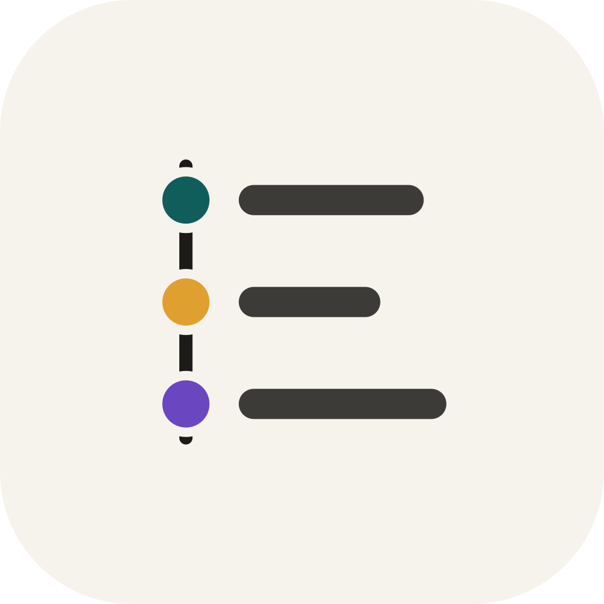

<p align="center">
  
</p>

<h1 align="center">生涯里程 LifeMilestones</h1>

<p align="center">
  把歷年的人生記錄，按時間軸整理成一本可以翻閱、搜尋、統計的年鑑。<br>
  Android APP・資料只在你的手機與你自己的 Google 帳號・開源（MIT）
</p>

<p align="center">
  <a href="https://github.com/Broooooook/life-milestones/releases/latest"><b>⬇ 下載最新版 APK</b></a>
  ・
  <a href="#english">English</a>
</p>

---

## 這是什麼

很多人有記錄人生大事的習慣：哪年換了工作、買了什麼、去了哪裡、誰結婚包了多少禮金……但這些記錄常常散落在記事本或文件裡，越寫越長、越難找。

生涯里程把它們變成一條時間軸：

- **總覽**：每一年一列，一個圓點代表一件事，顏色代表分類；右側顯示你標記 ★ 的大事。
- **時間軸**：一頁一年，左右滑動換年份；可選「舊→新」或「新→舊」。
- **那年今天、即將到來**：總覽上方提醒「8 年前的今天…」與快到的紀念日。
- **統計**：收入（年所得、紅利、調薪）、支出、物品、車輛、健康、人物。
- **年度回顧卡片**：一鍵產生當年的回顧圖卡，可以存成圖片或分享。
- **匯出到 Google**：單向備份成排版好讀的 Google 文件（年份就是標題，可用大綱跳轉）＋ Google 試算表，也能從 Google 還原。

第一次打開會看到幾筆**虛構的範例事件**，熟悉之後按「清除範例」就能開始記錄自己的。

## 功能一覽

| 功能 | 說明 |
| --- | --- |
| 智慧日期 | `2008` 是年度大項、`2008/2` 是月份大項、`2008/2/19` 是當天；期間用 `~`（`2001/6/22~2003/4/24`）；也接受 `2008年2月19日`、民國 `111/8/23` |
| 分類 | 收入、購物、車輛、健康、家庭人生、人情、旅遊、時事 |
| 照片 | 從相簿（多張）或相機加入，全螢幕可縮放；匯出時一起備份到雲端硬碟 |
| ★ 標記 | 標記的事件會顯示在總覽右側與年度回顧 |
| 人物標籤 | 點一個人，就能看到他出現在你人生中的所有時刻 |
| 物品用了多久 | 購物／車輛可設「還在用」或「已汰換」，自動算出用了幾年、每年平均花多少 |
| 年齡軸 | 設定出生年月，每年旁邊顯示當時幾歲 |
| 每年紀念 | 結婚、交屋等事件，快到時提醒「第幾週年・還有幾天」 |
| 當年的錢值多少 | 依行政院主計總處消費者物價指數，換算成今天的幣值 |
| 外觀 | 紙感淺色／深色、四種強調色、字型大小 |
| APP 上鎖 | 4–6 位 APP 密碼，可加指紋／臉部解鎖，可設定離開多久後上鎖 |

## 安裝

1. 在手機上打開 [Releases](https://github.com/Broooooook/life-milestones/releases/latest)，下載 `LifeMilestones-v*.apk`。
2. 點開安裝。手機會詢問是否允許「安裝不明來源的應用程式」，允許即可。
3. 之後有新版本，下載安裝會直接覆蓋，資料保留。

需要 Android 7.0 以上。

## 備份到 Google（選用，只要設定一次）

APP 不經過任何第三方伺服器。備份是透過**你自己 Google 帳號裡的一小段 Apps Script** 完成的，所以資料只會在你的手機和你的雲端硬碟。

建議在電腦上操作：

1. 打開 [`google/Code.gs`](google/Code.gs)，複製全部內容（APP 的「設定 → 匯出到 Google」也有「複製程式碼」按鈕）。
2. 到 [script.google.com](https://script.google.com) →「新專案」→ 刪掉原本的內容、貼上 → 儲存。
3. 右上角「部署」→「新增部署作業」→ 類型選「網頁應用程式」。
   - 執行身分：**我**
   - 誰可以存取：**所有人**
4. 按「部署」並授權。會出現「Google 尚未驗證這個應用程式」，因為這是你自己的程式，按「進階」→「前往（不安全）」→「允許」即可。
5. 複製「網頁應用程式網址」（結尾是 `/exec`），貼到 APP 的「設定 → 匯出到 Google」，按「儲存並測試」。

第一次測試時，手機會和你的 Apps Script **配對**，之後其他人就算拿到網址也無法寫入。

匯出後，雲端硬碟會有一個「生涯里程」資料夾，裡面有：

- **生涯里程記事（APP 備份）**：Google 文件，年份是標題、事件依日期排列、細項縮排、照片縮圖。
- **生涯里程記事（APP 備份）**：Google 試算表，一列一筆，可以篩選。
- **生涯里程備份（APP 還原用）.json**：完整備份，給「從 Google 還原」用。
- **照片**資料夾。

**換手機**：先在舊手機的「匯出到 Google」複製**配對碼**並存好。新手機裝好後，貼上同一個網址、輸入配對碼，再按「從 Google 還原」。如果配對碼弄丟了，在 Apps Script 編輯器選 `resetPairing` 函式按「執行」，就能重新配對。

## 隱私

- 所有事件與照片都存在手機的 APP 資料夾。
- APP 只會連到你自己設定的 Apps Script 網址，沒有廣告、沒有追蹤、沒有作者的伺服器。
- APP 密碼只儲存加鹽的 SHA-256 雜湊。
- ⚠️ 忘記 APP 密碼就打不開，只能移除重裝，之後再從 Google 還原。

## 自己打包

這是一個 [Flutter](https://flutter.dev) 專案（Dart）。

- **用 GitHub Actions（不用裝任何東西）**：Fork 這個 repo，到 Actions 頁面執行「Build APK」，完成後在該次執行的 Artifacts 下載 APK。沒有設定簽章 Secret 時會用暫時金鑰，可以安裝，但不能覆蓋官方版本。
- **在電腦上**：安裝 Flutter 後執行：

  ```bash
  flutter create --platforms=android --org tw.lifemilestones --project-name life_milestones .
  flutter pub get
  dart run flutter_launcher_icons
  flutter build apk --release
  ```

  `flutter create` 只會補上缺少的 Android 專案檔。正式打包時對 `AndroidManifest.xml` 與 `MainActivity` 的調整（網路權限、生物辨識、`FlutterFragmentActivity`）請參考 [`.github/workflows/build.yml`](.github/workflows/build.yml)。

### 專案結構

```
lib/
  main.dart            進入點、主題、底部頁籤
  models.dart          事件、智慧日期解析
  store.dart           本機儲存、設定
  export.dart          匯出／還原（Apps Script）
  lock.dart            APP 上鎖
  photos.dart          照片
  cpi.dart             消費者物價指數（主計總處）
  screens/             各頁面
google/Code.gs         放在使用者 Google 帳號的 Apps Script
assets/sample.json     範例資料（虛構）
```

歡迎開 Issue 回報問題或提出建議，也歡迎 Pull Request。

## 授權

[MIT](LICENSE) © 2026 Broooooook

物價指數資料來源：行政院主計總處《物價統計月報》。

---

<a id="english"></a>

## English

**LifeMilestones (生涯里程)** is an Android app for keeping a personal timeline of life events: jobs, purchases, trips, family milestones, income, health and more. It is designed for Traditional Chinese users (the UI is in Chinese).

- **Overview & timeline**: one row per year with colored dots per event; swipe year by year; star the moments that matter.
- **Smart dates**: type `2008`, `2008/2` or `2008/2/19`; ranges with `~`; ROC years supported.
- **Stats**: income, spending, how long you kept each item, car, health, people.
- **Year-in-review card**: generate and share a summary image for any year.
- **Photos, people tags, anniversaries, age axis, inflation-adjusted prices** (Taiwan CPI).
- **Private by design**: data stays on your phone. Optional one-way backup to a readable Google Doc and Google Sheet (plus a restorable JSON) through an Apps Script deployed in **your own** Google account. No third-party servers, no ads, no tracking.
- **App lock** with a PIN and optional fingerprint/face unlock.

**Install:** download the APK from [Releases](https://github.com/Broooooook/life-milestones/releases/latest). Android 7.0+.

**Google backup setup:** see [`google/Code.gs`](google/Code.gs). Deploy it as a web app (execute as *me*, access *anyone*) and paste the `/exec` URL into *Settings → 匯出到 Google*.

**Build:** Flutter project. Fork the repo and run the *Build APK* workflow, or see the commands above.

License: [MIT](LICENSE). CPI data: Directorate-General of Budget, Accounting and Statistics (DGBAS), Taiwan.
